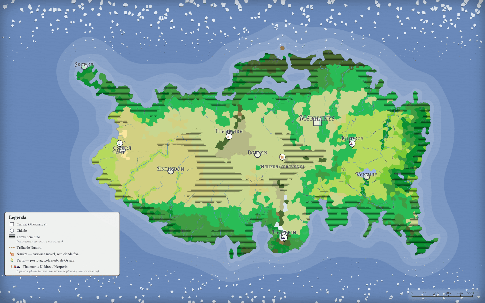

# 10 — O continente

Doryan está no meio de tudo, e a Lança manda soldado para longe quando precisa. O recruta sabe o mapa antes de sair pelo portão.

## O mapa

**Art. 97.** **O continente se chama Khaerys, e é este.** As dez cidades estão marcadas, e o quadrado é a capital. O que está riscado são as Terras Sem Sino ([02](02-o-ceu.md)); o que não está riscado ouve sino. O soldado estuda o mapa no quartel e o leva na cabeça.

*Khaerys. Riscado, as Terras Sem Sino, mais densas no centro e nas bordas. Toque no mapa para abri-lo inteiro.*

## Não há saída

**Art. 98.** **Khaerys não tem saída.** Não há muro: há distância, há fera, e há o fato de que **ninguém que saiu voltou**. Barco parte de Skorra e não volta. De fora, em cem anos, não veio ninguém. A Lança não manda ninguém para fora e não espera ninguém de fora.

## A regra do chão

**Art. 99.** **Terra boa dá gema; terra morta não** ([03](03-o-sol-a-lua-e-as-gemas.md)). Por isso a cidade se ergue onde nada cresce: sal, lava velha, rocha nua, caverna ou água funda. E come de um pedaço de terra boa do lado de fora do muro, sondado sem parar e atravessado por comboio. Mekhanys e Anthedon se ergueram em terra boa, e pagam por isso todo dia: uma com o Véu, a outra com milícia. **Doryan não recuou** ([01](01-o-mundo.md)): está no centro, e em volta dela a terra é a mais disputada do continente ([07](07-o-ermo.md)).

**Art. 100.** **Água funda é o chão mais limpo que há.** Lago e mar não dão gema, não têm ninho e não pedem farol. É por isso que Velmire dorme sem sino e Skorra ainda tem porto. O problema de quem sai de barco nunca foi o mar.

## As dez cidades

**Art. 101.** O quadro, com a distância de Doryan em Fios ([08](08-a-caca.md)):

| Cidade | Fios | O que o soldado precisa saber |
|---|---|---|
| **Doryan** | — | Aqui ([11](11-doryan.md)) |
| **Thaumara** | 3 | Torres e academias, atrás de Véu. Estuda a magia que não precisa de gema. É a cidade mais perto de Doryan, e ainda assim são três Fios |
| **Mekhanys** | 6 | A capital; chamam de a Forja. O Véu de Doryan é dela, a licença do Cravador é dela, e as duas se pagam em gente ([11](11-doryan.md)). O que existe de resposta em Khaerys está lá, e não se vende |
| **Anthedon** | 7 | O celeiro do continente. Enorme, rica, sem Véu e sem Lança: vive de milícia e colhe sem parar |
| **Hesperin** | 7 | Subterrânea. Nunca vê o céu |
| **Kaldros** | 8 | Sobre lava velha. Forja as armas imbuídas ([09](09-armas-forja-e-botica.md)). Ninguém quer morar lá, e a Lança precisa deles |
| **Velmire** | 9 | Plataformas sobre lago fundo. A água protege: é onde se dorme sem sino |
| **Ossara** | 11 | Salina, no oeste. Sem Véu, vive de farol e depende de tudo o que vem de fora |
| **Skorra** | 16 | Porto morto, na ponta noroeste. Quem vai embora vai por lá, e quem fica, fica esperando |
| **Naukra** | — | Cidade que anda: faróis sobre rodas, sem chão fixo. Não tem distância, tem trilha |

**Art. 102.** **Os Fios do quadro são conta de estrada, de portão a portão.** Terreno ruim soma; nada subtrai. Saída de vários trechos é saída de Alvado ([11](11-doryan.md)), e o sino se combina antes de sair ([08](08-a-caca.md)).

## O Véu

**Art. 103.** **Três cidades têm Véu: Mekhanys, Doryan e Thaumara.** Nenhuma outra. O Véu é de Mekhanys, que não o vende, não o ensina e não o explica. Fora das três, a cidade vive de farol ([01](01-o-mundo.md)): o farol guarda um trecho de muro, o Véu guarda a cidade inteira. O marcado atravessa o Véu das outras duas como atravessa o daqui ([11](11-doryan.md)): na fila, e sem reclamar.

## Entre as cidades

**Art. 104.** **Entre uma cidade e outra estão as Terras Sem Sino** ([02](02-o-ceu.md)), e são quase tudo. Não é deserto vazio: tem estrada velha, ruína, vilarejo morto e ninho ([07](07-o-ermo.md)), e a coisa ruim engrossa para o centro e para as bordas. Doryan está no centro.

**Art. 105.** **Fora do portão, o soldado é o relógio** ([02](02-o-ceu.md)). Patrulha de vários trechos leva guia Sem-Sino quando a patente paga ([09](09-armas-forja-e-botica.md)); quando não paga, leva quem conte a virada no corpo. A escolta é serviço de patente ([11](11-doryan.md)): curta para o Conto, de vários trechos para o Alvado. O comboio que sai sem a Lança é problema de quem saiu.
